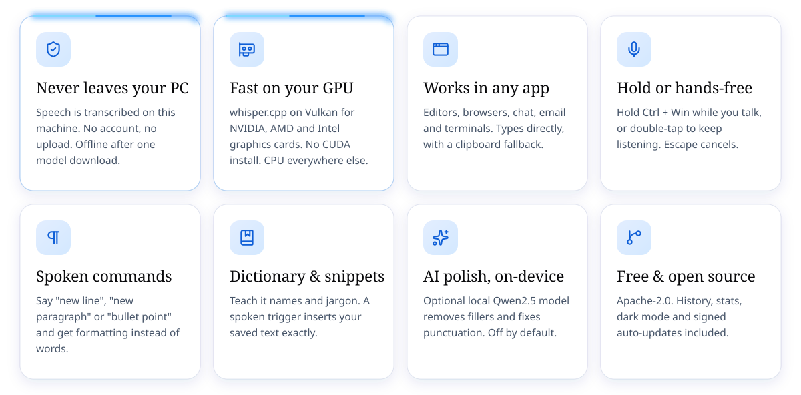

<div align="center">

<picture>
  <source media="(prefers-color-scheme: dark)" srcset="docs/readme/hero-dark.svg">
  
</picture>

<br><br>

<a href="https://github.com/rithwik1510/VoiceWave-Open-Source-WhisperFlow-Alternative/releases/latest"></a>

<p>
  <a href="https://github.com/rithwik1510/VoiceWave-Open-Source-WhisperFlow-Alternative/releases/latest"></a>
  <a href="https://github.com/rithwik1510/VoiceWave-Open-Source-WhisperFlow-Alternative/releases"></a>
  <a href="LICENSE"></a>
  
</p>

Free and open source · Works offline after a one-time model download · English

</div>

## How it works

<picture>
  <source media="(prefers-color-scheme: dark)" srcset="docs/readme/demo-dark.svg">
  
</picture>

1. **Hold Ctrl + Win and talk.** Double-tap the shortcut to go hands-free; Escape cancels.
2. **Let go.** Your speech is transcribed on your PC: on the graphics card through Vulkan
   when it qualifies, otherwise on the CPU.
3. **The text lands at your cursor**, in whatever app you were using.

## What you get

<picture>
  <source media="(prefers-color-scheme: dark)" srcset="docs/readme/features-dark.svg">
  
</picture>

## Never leaves your PC

<picture>
  <source media="(prefers-color-scheme: dark)" srcset="docs/readme/privacy-dark.svg">
  
</picture>

There is no VoiceWave server and no account. Audio stays in memory and is transcribed on your
machine. VoiceWave goes online for three things only:

- **Model downloads**, once: the speech model at setup, and the AI polish model if you turn it on.
- **Update checks** against GitHub. Updates are signed and verified before they install.
- **An anonymous usage count**, on by default, which you can turn off during setup or in
  Settings → Diagnostics. [What it sends](#anonymous-usage-count)

## AI polish, on your machine

<picture>
  <source media="(prefers-color-scheme: dark)" srcset="docs/readme/polish-dark.svg">
  
</picture>

Optional and off by default. A small local model (Qwen2.5 1.5B through llama.cpp) tidies fillers,
casing and punctuation, with profiles for Standard, Coding and Writing (Literal skips it). A
fidelity check rejects rewrites that drift from what you said and keeps the plain transcript
instead. It is a one-time download of about 1 GB and needs a CPU with AVX2.

## Install

1. Download `VoiceWave.Local.Core_<version>_x64-setup.exe` from the
   [latest release](https://github.com/rithwik1510/VoiceWave-Open-Source-WhisperFlow-Alternative/releases/latest)
   and run it.
2. **Windows may warn "Windows protected your PC" (Unknown publisher).** The installer is not
   code-signed yet, so SmartScreen does not recognise it. Choose **More info → Run anyway**. Every
   installer is built in public by [GitHub Actions](.github/workflows/release.yml) from this
   repository, and in-app updates are signed and verified before they install.
3. **First launch** checks your microphone and downloads one speech model, chosen for your PC:
   about 488 MB (Small) up to 1.6 GB (Large Turbo). After that, dictation works offline.

Or install with `winget install VoiceWave.LocalCore`.

### Requirements

|                    | Needs                                                                                                                        |
| ------------------ | ---------------------------------------------------------------------------------------------------------------------------- |
| **Windows**        | 10 or 11, 64-bit                                                                                                             |
| **CPU**            | x64 with SSE4.1. AVX2 is needed for the GPU engine and AI polish.                                                            |
| **GPU** (optional) | A discrete NVIDIA, AMD or Intel graphics card with Vulkan 1.2. PCs with only integrated graphics use the CPU engine for now. |
| **Language**       | English                                                                                                                      |

## Compared with cloud dictation

|                             |           **VoiceWave**           |                       Wispr Flow                        |
| --------------------------- | :-------------------------------: | :-----------------------------------------------------: |
| Price                       |             **Free**              | $15/month for Pro; free tier capped at 2,000 words/week |
| Where speech is transcribed |          **On your PC**           |                    On their servers                     |
| Works offline               | **Yes**, after the model download |                           No                            |
| Account required            |              **No**               |                           Yes                           |
| Open source                 |       **Yes** (Apache-2.0)        |                           No                            |

Wispr Flow details from [wisprflow.ai/pricing](https://wisprflow.ai/pricing), April 2026.

## Anonymous usage count

On by default for new installs since 0.6.1 (existing users were asked once). It helps show whether
people get through setup and whether dictation works for them. Turn it off during setup or in
**Settings → Diagnostics**. It is sent through [TelemetryDeck](https://telemetrydeck.com).

Every event carries a random installation ID, the app version, the download channel, and since 0.7.5
a few coarse facts about the setup: Windows 10 or 11, the GPU vendor (NVIDIA, AMD, Intel or none),
which speech model family is active, and whether it is running on the GPU or the CPU.

It counts only:

- your first successful dictation, and whether it ran on the GPU or the CPU;
- one "active today" marker per day, and one "launched today" marker (started with Windows or by hand);
- which setup step you reached, and whether setup finished or was skipped;
- a dictation failing, as a category such as "no speech heard" or "microphone missing";
- a speech or AI polish model download failing;
- the GPU engine falling back to the CPU, with a reason category;
- a speech worker crashing or timing out, or the app hitting an internal error, by area.

It never sends audio, transcript text, dictionary or snippet content, error messages, file paths,
device names, account details or settings.

## What's new in 0.7.0

- **GPU dictation on any vendor.** whisper.cpp runs on discrete NVIDIA, AMD and Intel graphics
  cards through Vulkan, in its own worker process. No CUDA download.
- **Picked per PC.** A one-time check confirms the GPU works before VoiceWave switches to it, and
  dictation steps down to the CPU automatically if the GPU misbehaves.
- **Verified GPU models.** whisper.cpp models are checked against pinned SHA-256 hashes before
  they replace anything.

Full history in the [changelog](CHANGELOG.md).

## Support

Something not working? In the app, **Help → Report a problem** opens a pre-filled GitHub issue
with your app version, Windows version and speech engine. You can also
[open an issue](https://github.com/rithwik1510/VoiceWave-Open-Source-WhisperFlow-Alternative/issues/new/choose)
directly. Logs never contain what you dictated.

## Build from source

<details>
<summary>Tauri 2 · Rust · React 18 · whisper.cpp · faster-whisper</summary>

<br>

| Layer      | What it is                                                                           |
| ---------- | ------------------------------------------------------------------------------------ |
| App shell  | Tauri 2, Rust core (audio capture, hotkeys, insertion, storage)                      |
| Interface  | React 18, TypeScript, Tailwind                                                       |
| GPU speech | whisper.cpp 1.9.5 worker processes (`voicewave-asr-vk.exe`, `voicewave-asr-cpu.exe`) |
| CPU speech | faster-whisper in a bundled Python runtime                                           |
| AI polish  | Qwen2.5 1.5B through llama-cpp-python, on the CPU                                    |

```powershell
npm install
npm run tauri:dev     # desktop app (needs the Rust + Tauri prerequisites)
npm run dev           # interface only, in a browser
npm test              # frontend tests
npm run build         # type-check and build the interface
```

The release build stages the Python runtime and the whisper.cpp workers; see
[`release.yml`](.github/workflows/release.yml) and the scripts under
[`scripts/`](scripts/). More in [CONTRIBUTING.md](CONTRIBUTING.md).

</details>

## License

[Apache-2.0](LICENSE). Contributions welcome: see [CONTRIBUTING.md](CONTRIBUTING.md).

Speech models are downloaded separately under their own licenses:

- [Parakeet TDT 0.6B v3](https://huggingface.co/nvidia/parakeet-tdt-0.6b-v3) by NVIDIA, the
  default model, licensed under [CC BY 4.0](https://creativecommons.org/licenses/by/4.0/).
  VoiceWave uses the [GGUF conversion by ggml-org](https://huggingface.co/ggml-org/parakeet-GGUF)
  as published, without changes.
- Whisper by OpenAI (Small and Large Turbo), MIT.
